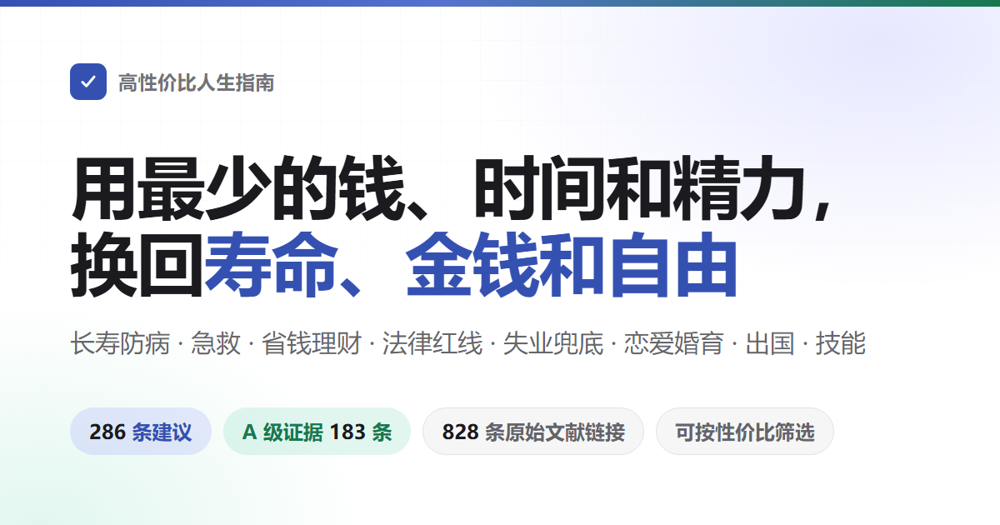

<div align="center">



# 高性价比人生指南

这是在上游正文上删减和修改的个人版。原先删除的条目不会因同步上游而恢复。

讲怎么活得久、怎么少生病，出了意外怎么救。讲怎么少花冤枉钱，哪些事会让人被骗、摊上官司。讲没工作没钱时能去领什么，开店、开公司、做网站要办什么手续。也讲恋爱结婚生孩子、出国和学手艺。法律、医保、社保这些制度上的内容，按中国大陆的现行规定写。<br>
286 条建议，每条写明花掉什么、换回什么、证据有多硬。数字和规则只引期刊论文和官方文件，少数案例另引符合条件的一手媒体报道。

不用全做：这是一份备选单，不是任务清单——挑走一两条就算数，作者自己也没做到其中大部分。

[](https://eternity4719.github.io/HowToLiveBetter/)
[](#目录)
[](#证据分级)
[](docs/核实记录/)
[](#许可)

### [打开在线检索页](https://eternity4719.github.io/HowToLiveBetter/) · [让 AI 照书回答（skill）](skills/life-decision-guide/README.md)

AI 助手 skill 支持 Claude Code 和 Codex。装上后直接问「替朋友担保签不签」，它先查书里的条目再回答，并注明出自第几节第几条。

<table>
<tr><td align="right"><b>下载</b></td><td align="left">

[PDF](https://github.com/eternity4719/HowToLiveBetter/releases/download/epub-latest/HowToLiveBetter.pdf) · [EPUB](https://github.com/eternity4719/HowToLiveBetter/releases/download/epub-latest/HowToLiveBetter.epub) · [离线单文件（HTML）](https://github.com/eternity4719/HowToLiveBetter/releases/download/epub-latest/HowToLiveBetter.html)

</td></tr>
<tr><td align="right"><b>查阅</b></td><td align="left">

[目录](#目录) · [术语表](#读懂数字术语表) · [核实记录](docs/核实记录/)

</td></tr>
<tr><td align="right"><b>自查</b></td><td align="left">

[生活自查](https://eternity4719.github.io/HowToLiveBetter/selfcheck.html)：回答几十道是否题，看看书里哪些事你还没做到、先做哪几件

</td></tr>
<tr><td align="right"><b>长文</b></td><td align="left">

[结婚划不划算](docs/结婚划不划算.md) · [家庭应急装备清单](docs/家庭应急装备清单.md) · [遇到陌生人出事该不该停](docs/遇到陌生人出事该不该停.md) · [做平台要办哪些证](docs/做平台要办哪些证.md) · [生物钟和夜班](docs/生物钟和夜班.md) · [被裁了之后先做什么](docs/被裁了之后先做什么.md) · [孩子出生前后要办的事](docs/孩子出生前后要办的事.md) · [刚确诊慢性病之后](docs/刚确诊慢性病之后.md)

</td></tr>
<tr><td align="right"><b>其他语言</b></td><td align="left">

[English](https://book.dlgrv.com/en/) · [Русский](https://book.dlgrv.com/ru/) · [Español](https://book.dlgrv.com/es/) · [Português](https://book.dlgrv.com/pt/) · [العربية](https://book.dlgrv.com/ar/) · [Bahasa Indonesia](https://book.dlgrv.com/id/)，[dlgrv](https://github.com/dlgrv) 维护的翻译（[仓库](https://github.com/dlgrv/HowToLiveBetter)）

[English（The Evidence-Based Life）](https://parveen0029.github.io/The-Evidence-Based-Life/)，[parveen0029](https://github.com/parveen0029) 维护的另一份英文翻译（[仓库](https://github.com/parveen0029/The-Evidence-Based-Life)）

[Tiếng Việt](https://chuanman2707.github.io/HowToLiveBetter/)，[chuanman2707](https://github.com/chuanman2707) 维护的越南语翻译（[仓库](https://github.com/chuanman2707/HowToLiveBetter)）

</td></tr>
<tr><td align="right"><b>衍生工具</b></td><td align="left">

[howtolivebetter.net](https://howtolivebetter.net/)，[littleben](https://github.com/littleben) 做的打勾清单：加待办、标记做到没有、收藏

[高性价比人生指南结构化数据集](https://github.com/sin0317/htlb-dataset)，[sin0317](https://github.com/sin0317) 做的结构化数据：上游正文解析成 JSON、CSV、SQLite，每天自动同步（正文 CC BY 4.0，代码 MIT）。数据集不是本分支删减版的数据源。

</td></tr>
</table>

<sub>其他语言和衍生工具由他人维护，内容可能落后，以本仓库中文原文为准。</sub>

</div>

---

## 这本书想回答的问题

| 问题 | 去哪看 |
| --- | --- |
| 怎么防住火灾、坠落和木耳中毒，疫苗、癌症筛查和骨质疏松、房颤用药怎么做？ | [1. 不要早死](book/01-不要早死.md) |
| 低钠盐、坚果、热饮温度、熬夜补觉和做饭用油怎么安排？ | [2. 不要慢慢死](book/02-不要慢慢死.md) |
| 睡眠不足、总被打断、反复想糟心事和情绪低落，怎么少耗精力？ | [3. 不要浪费精力](book/03-不要浪费精力.md) |
| 怎么落实计划、估工期，家务和刷屏怎样少占时间？ | [4. 不要浪费时间](book/04-不要浪费时间.md) |
| 自动续费、孩子充值、医保共济、指数基金、个人养老金和保险该怎么少花冤枉钱？ | [5. 不要浪费钱](book/05-不要浪费钱.md) |
| 复合维生素、普通鱼油、有机食品和搬运培训有什么用？ | [6. 反面清单](book/06-反面清单.md) |
| 失业、遇到变故、重病或信用卡还不上，能领什么、怎么协商和保住保障？ | [7. 没钱的时候怎么活](book/07-没钱的时候怎么活.md) |
| 被骗、被指控、被限高或被网暴，钱怎么保住、证据怎么留、程序怎么走？ | [8. 法律与财产安全](book/08-别把自己搭进去.md) |
| 骗保险和随身带防身器械，会有什么法律后果？ | [9. 普通人容易踩的法律红线](book/09-普通人容易踩的法律红线.md) |
| 结婚后的时间、财产、债务和退出成本怎么算，配偶打赏或离婚探望怎么定？ | [10. 恋爱和结婚划不划算](book/10-恋爱和结婚划不划算.md) |
| 写爬虫、报送漏洞、做 App 收个人信息，有哪些技术人要避开的红线？ | [11. 程序员和技术人容易踩的红线](book/11-程序员和技术人容易踩的红线.md) |
| 开店办公司，主体、加盟、报税、发票、进货、年报和合伙协议怎么处理？ | [12. 创业与做生意](book/12-创业与做生意.md) |
| 突发急症、大出血、烫伤、中毒、噎住、骨折和误吞电池，先做什么？ | [13. 紧急情况：先做什么](book/13-紧急情况.md) |
| 二次验证、SIM 卡 PIN、手机丢失和盗刷，第一步做什么？ | [14. 账号与信息安全](book/14-账号与信息安全.md) |
| 租房押金、房东赶人、中介代收，以及买房产权核对、认购退钱和验房保修怎么避坑？ | [15. 租房与买房](book/15-租房与买房.md) |
| 确诊慢性病之后，服药、慢特病异地备案、长期处方和糖尿病筛查怎么管？ | [16. 得了慢性病之后怎么活](book/16-得了慢性病之后怎么活.md) |
| 老人的监护、遗嘱、账户、长护险、压疮、养老院押金和记忆门诊怎么安排？ | [17. 家里有老人](book/17-家里有老人.md) |
| 生孩子能领什么、产假陪产假怎么休、要占掉多少时间和钱？ | [18. 养孩子划不划算](book/18-养孩子划不划算.md) |
| 加班费、年休假、工伤认定、离职证明、违约金、调岗降薪和劳务派遣怎么处理？ | [19. 在职、离职和工伤](book/19-在职离职和工伤.md) |
| 孩子刚出生，安全睡眠、疫苗、母乳、黄疸、学步车和洗澡防烫要注意什么？ | [20. 刚出生的孩子怎么带](book/20-刚出生的孩子怎么带.md) |
| 出国前怎么查中介和带药规定，取现带现金限额多少，领事保护能帮到哪里？ | [21. 出国、旅行与境外安全](book/21-出国旅行与境外安全.md) |
| 去 KTV、密室怎么看安全出口，压力大时做什么最有用？ | [22. 怎么放松：娱乐场所和减压](book/22-怎么放松.md) |
| 学技能怎么优先用上人社部门的政府补贴培训？ | [23. 学什么技能划算](book/23-学什么技能划算.md) |
| 病历怎么留存封存，伤残鉴定和残疾人证怎么办，谈判药双通道和住院清单怎么核？ | [24. 看病：怎么少花钱少走弯路](book/24-看病.md) |
| 家里人走了，当时先做什么、哪些钱能取回来、遗产债务和继承怎么跑？ | [25. 人走了以后要办什么](book/25-人走了以后要办什么.md) |
| 做个网站或平台收钱，要办哪些证、服务器放哪、信息泄露和自动续费怎么合规？ | [26. 做一个网站或平台](book/26-做一个网站或平台.md) |
| 怀孕了、要生了，什么时候做什么，出院前要办哪些证？ | [27. 怀孕和生产](book/27-怀孕和生产.md) |
| 外形与身体相关章节（条目已清空，仅保留章节占位） | [28. 别为了外形把身体搞坏](book/28-别为了外形把身体搞坏.md) |
| 亲人走了、被裁了、拿到重病诊断，头几天和头几周最要紧的是什么？ | [29. 遭遇重大打击之后](book/29-遭遇重大打击之后.md) |
| 孩子被欺凌、体检异常、抑郁、近视、沉迷游戏、家里总打骂或防性侵，怎么做？ | [30. 上学以后的孩子](book/30-上学以后的孩子.md) |
| 不进单位时，灵活就业社保、平台职业伤害保障、远程工作报税和创业贷款怎么算？ | [31. 十八岁之后有哪几条路](book/31-十八岁之后有哪几条路.md) |
| 美国留学搬家后怎么报地址，OPT 失业天数上限是多少？ | [32. 出国留学：身份、打工、保险和回国认证](book/32-出国留学.md) |
| 残疾后遇到急症、精神住院、长期照护、轮椅减压和无障碍改造怎么办？ | [33. 残疾之后怎么活](book/33-残疾之后怎么活.md) |
| 感冒药、退烧药、胃药自己买来吃，哪些不能一起吃，孩子、孕妇和开车的人要避开哪些？ | [34. 家里的常备药别吃出事](book/34-家里的常备药别吃出事.md) |

## 怎么读

- **不用全做**：这是一份备选单，不是任务清单。挑走一两条就算数，剩下的放着，需要时再回来查。「说着容易做着难」这个评价是对的——作者自己也没做到其中大部分，写下来是为了要用的时候找得到。想挑省力的，看下面「只想看最值得做的」那条。
- **想让 AI 帮你查**：仓库里带了一个中文 skill（[skills/life-decision-guide](skills/life-decision-guide/)），Claude Code 和 Codex 都能装。装上以后直接问「替朋友担保签不签」「个人养老金税率只有 3% 时值不值」。它会先把相关条目从正文里查出来，再照书里的算账方式排序回答，并注明出自第几节第几条。查不到就说查不到，不自己编数字。装法见 [那个目录的说明](skills/life-decision-guide/README.md)。
- **想按条件挑**：打开[在线检索页](https://eternity4719.github.io/HowToLiveBetter/)，可以按关键词、章节、证据等级来筛，也可以按「花不花钱、花多少时间、要不要毅力」这三样筛，几个条件能叠着用。页面上的内容直接取自 book/ 目录里的正文，正文一改，页面跟着改。
- **条目之间会互相指路**（「见第 8 节第 13 条」这种）：在检索页里，这种指路带一条虚线。点一下，就地显示被指的那条的标题和「说人话」。想真的翻过去，再按「跳过去」。那一条正好被筛选条件藏起来了，页面会自动把筛选清掉。在 GitHub 上直接读正文点不动，但每处指路后面都写着指向什么（「见第 18 条（借钱写清借条）」）。不翻过去也知道说的是哪条。
- **想按顺序读**：每节内的先后顺序不代表性价比高低。条目多的节开头有一段分组导览，按主题挑着看就行。
- **想离线看、想发给别人**：下载 [离线单文件 HTML](https://github.com/eternity4719/HowToLiveBetter/releases/download/epub-latest/HowToLiveBetter.html)，整本书连同检索和筛选都在这一个文件里，双击就开，不用服务器也不用联网，微信里也能直接传。
- **想打印或在手机上翻**：下载 [PDF](https://github.com/eternity4719/HowToLiveBetter/releases/download/epub-latest/HowToLiveBetter.pdf)，A4 排版、两百多页，带目录页码和书签，每节另起一页。
- **想在 Kindle 或其他阅读器上读**：下载 [EPUB 电子书](https://github.com/eternity4719/HowToLiveBetter/releases/download/epub-latest/HowToLiveBetter.epub)，Kindle 用 Send to Kindle 发过去即可。
- **三样都是正文每次更新后自动重新生成的**，下载链接固定不变；转发出去的那一份不会跟着更新，以在线版为准。
- **看不懂那串数字**：每条都有一行「说人话」。它把「收益」栏里那些研究里的写法，翻成「同期死亡的概率低约两成」「拘留几日、罚多少钱」这样的日常说法。它只用「收益」栏已经写到的内容，不添新数字。只看这一行就够拿主意。「收益」栏里原样留着全部数字，想自己核对就看那一栏。
- **只想看结论最硬的**：在检索页里勾选证据等级 A，只留下有具体数字、来自荟萃分析或大型试验的 183 条。
- **只想看最值得做的**：勾选性价比「极高」，得到 52 条既不花钱、不花时间、不需要毅力，收益又落在最大一档的条目。再叠加一个「换回什么」，就是该口径下的优先清单。
- **看到「不要」开头的节标题不用紧张**：节标题说的是这一节想防住的事（不要早死、不要浪费时间），不是说底下每条都在让你别干什么。真正要做的动作写在条目标题里，一律动词开头，自己就写清了是「做什么」还是「别做什么」。同一节里两种都有：第 3 节既有「固定起床时间，周末也一样」，也有「一次只做一件事，不要边开会边回消息」。按条目标题读，不用往节标题的语气上套。

每条建议长这样：

```markdown
### 5. 把家里的食盐换成低钠盐（钾盐）
- 成本：一袋比普通盐贵几元。买的时候顺手换，不额外占时间。口味几乎不变。
- 说人话：得过中风或 60 岁以上有高血压的人，把家里的盐换成低钠盐，五年内死亡的概率低约 12%，中风低约 14%。
- 收益：一项把人随机分成两组的试验，在中国农村做的，20995 人，都是得过卒中的人或者 60 岁以上的高血压病人，跟踪了 4.74 年。结果：用低钠盐的那组比用普通盐的那组，死亡风险低约 12%（RR 0.88）。卒中低约 14%（RR 0.86）。主要心血管事件低约 13%（RR 0.87）。
- 证据等级：A
- 来源：Neal B 等 (2021). Effect of Salt Substitution on Cardiovascular Events and Death. NEJM. https://doi.org/10.1056/NEJMoa2105675
- 备注：争议。试验对象是高危老人，健康年轻人换盐得到的好处要小得多。肾功能不全的人，或者正在吃保钾类药物的人，换盐前先问医生。
```

## 自己跑一份

多数人用不着部署：[在线检索页](https://eternity4719.github.io/HowToLiveBetter/)是现成的，要离线就下[离线单文件 HTML](https://github.com/eternity4719/HowToLiveBetter/releases/download/epub-latest/HowToLiveBetter.html)，双击就开。

真要在自己电脑或服务器上跑：

```bash
git clone https://github.com/eternity4719/HowToLiveBetter.git
cd HowToLiveBetter
python -m http.server 8000
```

然后浏览器开 `http://localhost:8000/`。检索页是纯静态的，`README.md` 和 `book/` 就是它的数据，没有后端、没有数据库、不用装依赖；把整个目录丢给任何静态服务器（Nginx、GitHub Pages、对象存储）效果一样。注意 `index.html` 必须经 http 打开，直接双击本地文件会空白——浏览器不许网页读本地文件，那种场景请用上面的离线单文件版。

想自己生成三样电子版（平时用不着，Release 里的就是自动生成的）：

```bash
npm --prefix tools/epub ci && npm --prefix tools/epub run build   # EPUB
node tools/offline/build.mjs               # 离线单文件 HTML
node tools/pdf/build.mjs                   # PDF，另需 pandoc ≥ 3.1 和 typst ≥ 0.13
```

产物都在 `dist/`。

## 四种资源

这本书想帮你多留住的不只是寿命，一共四样东西：

- **寿命**：活得更久，少死于本来可以避免的事
- **时间与精力**：活着的时间不花在没有回报的事上，每天的注意力和体力少被白白耗掉
- **金钱**：少花冤枉钱，把钱花在收益确定的地方
- **人身自由**：不因为不知道一条红线，把自己送进拘留所或者看守所

每一条建议都回答两个问题：要花掉什么（钱/时间/精力/毅力），能换回什么（总死亡率变化 / 特定死因下降 / 时间与精力节省 / 金钱节省 / 保障与人身自由）。

**一条建议的好处落在谁身上，是分档的。** 按「这份好处将来有多大可能回到你自己身上」从高到低：① **你自己**；② **配偶和直系亲属**（父母、子女、祖父母外祖父母、孙子女外孙子女）；③ **朋友、同事和其他亲属**——互惠关系，帮出去的将来可能回来；④ **陌生人**——最低一档，但不是零：回报的概率小，而且你不了解对方性格，还有被讹、被反咬、被报复的一面。不同档不合并计算，写到第 ④ 档时好处和风险一起写。

急救那一节照这个读：中国 38,227 例院外心脏骤停里 79.2% 发生在家里，学按压首先是为了按在自家人身上；「看到有人溺水自己不下水」「撞见斗殴别上手拉架」这类规则本身就是自保规则，防的是你从旁观者变成第二个伤者。对陌生人要不要出手是你自己的权衡，条目会把免责条款、自保动作和风险面都写清楚，不替你把它算成非做不可的理由。

死亡率的数字、时间精力的数字、金钱的数字和法律后果，各算各的，不互相折算。这四样对应检索页上那四个「换回什么」，彼此之间不比大小。

## 证据分级

每条建议都标注证据等级：

| 等级 | 含义 |
| --- | --- |
| A | 有具体数字可查，出处是多项研究合并起来的荟萃分析、跟踪很多人很多年的大型队列，或者随机分组的试验（RCT），能说出降了多少（HR、RR、下降百分比） |
| B | 有研究支持，但说不出一个确切数字；或者只有小样本、单独一项研究撑着 |
| C | 作者自己的经验，或者大家公认的做法，没有直接的研究文献 |

全书 286 条中 A 级 183 条、B 级 84 条、C 级 19 条，另有 22 条标注了争议、0 处标注了 TODO 待核实。有争议的 A/B 级条目会标注「争议」并列出反方证据。数字、政策和法条只引原始文献（期刊论文附 DOI 或 PubMed 链接，或 WHO/CDC/国家统计局等官方机构报告）。少数案例引用记者署名的一手调查或现场报道，并附网页存档，只证明发生过这类事，不据此提高证据等级。转载、聚合和自媒体不收。不确定的数字标「待核实」。

A 级只说明「有具体数字、出处可核」，不说明这个数字一定是因果。A 级里既有随机分组的试验，也有只跟踪记录、不分组的研究，后者分不清是这件事起了作用，还是做这件事的人本来就更健康。哪一种看收益栏：写着「随机分成两组」的是前者，写着「只记录、不分组」的是后者。法律和政策类条目的 A 级，指的是引到了法条或官方文件原文。

收益栏和说人话里的百分比，多数是比没做的人低几成，不是每一百人里少几个。同样低 12%，本来风险就高的老人少掉的死亡人数，远多于本来风险就很低的年轻人。所以先看说人话里写的是哪些人，再看那个百分比。

## 性价比档

证据等级只回答「这个数字可不可信」，不回答「这件事值不值得做」。所以每条还另外标了两样：收益量级（好处有多大）和口径（换回的是哪一类东西）。检索页拿这两样加上三项成本，合出一个性价比档：

| 维度 | 取值 | 怎么定的 |
| --- | --- | --- |
| 口径 | 换寿命 / 换钱 / 换时间精力 / 换人身自由 | 看这条主要换回的是什么。**不同口径之间不做比较**，「总死亡率降 12%」和「每年省 500 元」不在一把尺子上，没法分高下 |
| 收益量级 | 大 / 中 / 小 | 尽量照着条目自己的「收益」栏，按事先定好的界线套，不凭感觉：换寿命看降了百分之几（≥20% 为大，10% 及以上、不到 20% 为中，<10%、或者只量到中间指标而没量到最终结果的为小）；换钱看金额（万元级为大，数百到数千为中，几十元为小）；换人身自由看后果（避免刑事责任为大，避免拘留或行政处罚为中，避免民事纠纷为小）；换时间精力看省下多少（每天省出小时级为大，每周小时级为中，只省一次的为小） |
| 性价比 | 极高 / 高 / 一般 | 好处大、三项成本又全是零 = 极高；好处大、成本不高，或者好处中等、成本为零 = 高；剩下的 = 一般 |

全书 286 条中性价比极高 52 条（18%）、高 131 条（46%）、一般 103 条（36%）。中间那档条数多是有意的：底下的收益量级本来就只分大、中、小三级，再往细里切就是装出来的精确。

**这一档是作者自己的判断，不是证据**，按本书的标准它本身只算 C 级；它和证据等级是两回事，谁也不影响谁。一条可以证据是 A 级、性价比却只算一般（带状疱疹疫苗有 97.2% 效力的三期 RCT，但两针三四千元、带状疱疹很少致命），也可以证据只有 C 级、性价比却极高（出境前把行程发给家人）。

这三档只拿来排先后：你只打算做十件事时，先从「极高」和「高」里挑。「一般」不是不值得做，只是它要么要花钱、要么要长期坚持，或者换回的不是一条命、几万元那一档。能随手做到的照样做。

## 读懂数字（术语表）

正文尽量用日常说法，但引用研究的时候免不了出现几个统计名词。看不懂就查这张表；在线检索页里，把鼠标停在带虚线的词上（手机上点一下）也会弹出解释。

<details>
<summary>展开 42 条术语（总死亡率、HR、RR、95% CI、荟萃分析、BMI、LPR、定金与订金……）</summary>

| 术语 | 意思 |
| --- | --- |
| 总死亡率 | 一段时间里，一群人当中死掉的人占多大比例，不管死于什么原因。本书用它衡量「活得久不久」。研究原文里叫全因死亡率，英文缩写 ACM |
| HR | 瞬时风险比。比较的是随访过程中，仍未出事的人在当时出事的快慢。HR 0.87 表示这一风险低 13%，不等于一段时间内出事的概率低 13% |
| RR | 相对风险。两组人在相同观察期内出事的概率之比。RR 0.87 表示相对低 13%，不是每一百人少出事 13 个 |
| OR | 比值比。先分别算出两组「出事的概率 ÷ 不出事的概率」，再比较这两个比值。它不等于概率之比，只有结局很少见时才近似 RR，不能一律换算成概率高几成、低几成 |
| IRR | 发病率之比。发病率是一段时间里新得这个病的人占多大比例，两组相除，读法同 RR |
| RaR | 发生次数之比。比的是事情发生了多少次（比如摔了多少跤），不是多少人出事，读法同 RR |
| 标准化死亡比 | 英文缩写 SMR。这群人实际死了多少人，除以「同样年龄的普通人本该死多少人」。5.86 就是死的人数是同龄人的 5.86 倍 |
| 风险差 | 两组出事的概率相减，直接得出「每一千人里多出几个」。倍数只说翻了几倍，风险差说的是实实在在多了多少人 |
| 95% CI | 95% 置信区间。研究算出的数字总有误差，这是真实情况很可能落在的范围。倍数类的数字，范围跨过了 1；加减类的数字，范围跨过了 0，就说明两组的差别可能只是碰巧，文中会写「无统计学意义」 |
| RCT | 随机对照试验。用抽签一样的办法把人分成两组，一组做这件事，一组不做，过后比结果差多少。要证明「是这件事起了作用」，这种做法最有说服力 |
| 荟萃分析 | 把很多项研究的结果凑到一起重新算，得出一个总的数字。也叫 meta 分析 |
| 队列 | 队列研究。挑一大群人跟踪很多年，记录谁出了事。能看出两件事常一起出现，但不足以证明是前一件造成了后一件 |
| 观察性 | 观察性研究。研究者只在旁边记录，不安排谁做、谁不做。结果容易被别的因素带偏（见本表的混杂、反向因果两条），数字要打点折看 |
| 混杂 | 有第三个因素同时牵动着前因和后果，让两件事看起来像有因果。比如爱吃菜的人往往也更爱运动，分不清是哪一样在起作用 |
| 反向因果 | 因果的方向弄反了：看着像前一件引起后一件，其实是后一件引起前一件。不是睡得多让人早死，而是病重的人睡得多 |
| d、g | 效应量，表示两组的差距有多大。把差距换算成「相当于几倍的常见波动幅度」：0.2 算小，0.5 中等，0.8 大 |
| r | 相关系数。两件事跟着一起变的紧密程度，取值从 -1 到 1，0.1 算弱、0.3 中等、0.5 算强 |
| MET | 运动强度的单位。安静坐着是 1 MET，快走约 3 到 4 MET。写成 MET·h，就是强度乘以做了几小时，表示一共动了多少 |
| GRADE | 国际上通用的一套打分办法，给一项证据有多可靠评级，分高、中、低、极低四档 |
| 意向筛查分析 | 算效果时按「通知了谁去做筛查」算，不按「谁真的去做了」算。被通知的人里总有没去的，所以这种算法会把筛查对真去做的人的好处算低 |
| 包年 | 统计一个人一共抽了多少烟的单位。每天抽几包乘以抽了几年，30 包年就是每天一包抽了 30 年 |
| BMI | 体重指数，看胖瘦常用的一个数：体重的公斤数，除以身高米数的平方 |
| LDL | 低密度脂蛋白胆固醇，俗称坏胆固醇 |
| eGFR | 估算肾小球滤过率，衡量肾脏过滤能力的一项指标，单位 mL/min/1.73 m²。数越低说明肾功能越差，慢性肾病分几期就按它定 |
| HBsAg | 乙肝表面抗原，化验单上的一项。结果是阳性，表示已经感染了乙肝病毒 |
| HPV | 人乳头瘤病毒。它分很多型，其中一部分型长期感染会导致宫颈癌 |
| PM2.5 | 飘在空气里的细颗粒物，直径在 2.5 微米以下 |
| LPR | 贷款市场报价利率。国内贷款利率的基准，每月 20 日公布一次，房贷利率和民间借贷的利息上限都照着它算 |
| 一裁终局 | 劳动仲裁的结果下来就直接生效，单位不能再拿这件事去法院起诉 |
| 粗结婚率、粗离婚率 | 每一千人里，当年登记结婚、登记离婚的对数。另外还有个数叫离结比，是当年离婚对数除以结婚对数，和这两个不是一回事，别混着看 |
| AED | 自动体外除颤器。公共场所常见的红色或黄色急救箱，开机以后跟着语音提示做就行，要不要电击由它自己判断 |
| CPR | 心肺复苏。心脏骤停时用力按压胸口，让血继续流动 |
| 3C 认证 | 中国强制性产品认证。列进目录的那些产品，没印这个标志就不准出厂、不准卖 |
| ICP 备案 | 网站或 App 正式上线之前，到工信部的系统里登记一道手续 |
| 等级保护 | 网络安全等级保护制度。按一套系统有多重要分成几个级别，级别越高，要做的安全措施越多 |
| GPL | 一种开源许可证。用了这类代码做出来的东西，往外发的时候通常也得把自己的代码一起公开 |
| 竞业限制 | 和公司签的一种约定：离职后一段时间内不去同行的对手那里上班。这段时间公司要按月给你补偿，最长 2 年 |
| 认缴出资 | 注册公司时承诺要投进去的钱。承诺了就得在法律定的期限内真掏出来，不是写个数字好看 |
| 定金与订金 | 两个词只差一个字，效力差很多：定金有罚则，收钱的一方反悔要双倍退还，金额最多为合同额的 20%；订金只是提前付的钱，反悔没有这个罚则 |
| 一审按规定 6 个月内审完 | 书里说的是法律给法院定的期限，不是实际要等多久。民事案子一审走普通程序，法院要在立案后 6 个月内审完，有特殊情况经批准可以延长。走简易程序的是 3 个月。做鉴定、公告送达的时间不算在里面，所以实际常常比这更久 |

</details>

## 目录

1. [不要早死](book/01-不要早死.md)：烟雾与一氧化碳报警器、窗户限位器、破伤风与成人疫苗、结直肠癌与胃镜筛查、幽门螺杆菌、家庭应急装备、骨质疏松用药、房颤抗凝和泡发木耳。口径：总死亡率或特定死因。长文见 [docs/家庭应急装备清单.md](docs/家庭应急装备清单.md)。
2. [不要慢慢死](book/02-不要慢慢死.md)：低钠盐、坚果、热饮温度、熬夜补觉和植物油替代猪油。口径：总死亡率或特定死因。长文见 [docs/生物钟和夜班.md](docs/生物钟和夜班.md)。
3. [不要浪费精力](book/03-不要浪费精力.md)：固定起床、睡眠时长、防打断、单任务、睡前屏幕与午睡、反复想糟心事、情绪低落和聚光灯效应。口径：精力/时间。
4. [不要浪费时间](book/04-不要浪费时间.md)：执行计划、退出条件、工期估计、改环境、押金承诺、家务外包、短视频上限和快捷键自动化。口径：时间。
5. [不要浪费钱](book/05-不要浪费钱.md)：自动续费、孩子充值退款与防骗、拒绝延保、医保共济、宽基指数基金、个人养老金、预付款与网购维权、三者险与人身险、止损与海外资产渠道、跟团游退货。口径：金钱。
6. [反面清单](book/06-反面清单.md)：复合维生素、普通鱼油、有机食品和搬运姿势培训。
7. [没钱的时候怎么活](book/07-没钱的时候怎么活.md)：失业保险、临时救助、重病报销、就业补贴、社保断缴、医疗险和信用卡协商分期。口径：金钱/保障。
8. [别把自己搭进去：法律与财产安全](book/08-别把自己搭进去.md)：被骗止付、被指控请律师、查征信、极端暴力自救与送诊、诉讼时效与限高纠正、网购维权、彩礼与婚前财产、国家赔偿、依法索赔、网暴防护和报警取证。口径：金钱/人身自由。
9. [普通人容易踩的法律红线](book/09-普通人容易踩的法律红线.md)：保险诈骗和防身器械携带风险。口径：人身自由/金钱。
10. [恋爱和结婚划不划算](book/10-恋爱和结婚划不划算.md)：婚后的时间账、财产约定、父母出资、夫妻债务、退出成本、吵架与伴侣治疗、补办结婚证、配偶打赏或转给第三者、离婚抚养费与探望。长文见 [docs/结婚划不划算.md](docs/结婚划不划算.md)。
11. [程序员和技术人容易踩的红线](book/11-程序员和技术人容易踩的红线.md)：技术风险总纲、爬虫边界、漏洞报送和 App 个人信息合规。口径：人身自由/金钱。
12. [创业与做生意：别把家底赔进去](book/12-创业与做生意.md)：主体选择、加盟核查、零申报、发票、定金账期、预售验证、量产、进货、图案授权、年报、商铺选址和书面合伙协议。口径：金钱/法律责任。
13. [紧急情况：先做什么](book/13-紧急情况.md)：倒地先判断、眼中风、青光眼、主动脉夹层、霹雳样头痛、肺栓塞、大出血、咬伤、烧烫伤、过敏、低血糖、触电、一氧化碳、误服、化学品灼伤、噎住、失温、蛇咬、雷击、蜱虫、救人后的待遇、穿透伤、骨折、婴儿噎住和吞纽扣电池磁珠。口径：存活率，部分条目兼及金钱与人身自由。
14. [账号与信息安全](book/14-账号与信息安全.md)：二次验证、锁屏与 SIM 卡 PIN、手机丢失、银行卡盗刷、登录设备清理、个人信息权利和一证通查。口径：金钱/个人信息。
15. [租房与买房](book/15-租房与买房.md)：押金约定、暴力腾退、中介禁代收、产权核对、二手房资金专户、新房认购退钱、面积误差和收房保修。口径：金钱。
16. [得了慢性病之后怎么活](book/16-得了慢性病之后怎么活.md)：按医嘱服药、门诊慢特病与异地备案、复查记录、长期处方、家庭医生和糖尿病并发症筛查。口径：总死亡率/金钱。长文见 [docs/刚确诊慢性病之后.md](docs/刚确诊慢性病之后.md)。
17. [家里有老人](book/17-家里有老人.md)：意定监护、遗嘱、老人账户、长期护理保险、压疮防护、养老院备案与押金、独生子女护理假和记忆门诊。口径：金钱/人身自由，压疮和记忆门诊按死亡率。
18. [养孩子划不划算](book/18-养孩子划不划算.md)：育儿补贴、产假与陪产育儿假、时间账和钱账。口径：金钱/时间。
19. [在职、离职和工伤](book/19-在职离职和工伤.md)：加班费、年休假、离职留证、工伤认定、单位未参保、劳动能力鉴定、离职证明、补偿个税、跨城市社保转移、离职违约金、调岗降薪异议和劳务派遣。口径：金钱。长文见 [docs/被裁了之后先做什么.md](docs/被裁了之后先做什么.md)。
20. [刚出生的孩子怎么带](book/20-刚出生的孩子怎么带.md)：安全睡眠、乙肝首针、免疫规划疫苗、母乳与辅食、冲奶水温、蜂蜜、维生素 K、发热就医红线、大件采购、高危孩子早引入花生防过敏、新生儿黄疸、素食补 B12、不买学步车和洗澡防烫。口径：婴儿死亡率/金钱。
21. [出国、旅行与境外安全](book/21-出国旅行与境外安全.md)：领事保护边界、境外取现与携带现金限额、中介备案、行程报备和出国带药查规定。口径：金钱/人身自由。
22. [怎么放松：娱乐场所和减压](book/22-怎么放松.md)：娱乐场所安全出口和密室选址，以及运动、正念、循环叹息、定期见人和绿地。口径：人身自由，以及精力/总死亡率。
23. [学什么技能划算](book/23-学什么技能划算.md)：政府补贴培训渠道。口径：金钱。
24. [看病：怎么少花钱少走弯路](book/24-看病.md)：病历影像留存、病历封存、伤残鉴定、残疾人证、不用给医生送红包、双通道买谈判药、互联网医院复诊和核对住院清单。口径：金钱/时间。
25. [人走了以后要办什么](book/25-人走了以后要办什么.md)：报警与死亡证明、遗体接运与火化、死因异议与尸检、注销户口、殡葬基础项目清单、价格违法、公积金余额与社保待遇、死者个人信息权利、遗产清偿以遗产为限和简化继承手续。口径：金钱。
26. [做一个网站或平台：资质、备案和服务器](book/26-做一个网站或平台.md)：支付结算红线、ICP 与 EDI 许可、直播和视听资质、内容治理、实名、通知删除、服务器选型、信息泄露通知和自动续费提醒。口径：人身自由/金钱。长文见 [docs/做平台要办哪些证.md](docs/做平台要办哪些证.md)。
27. [怀孕和生产：从发现怀孕到出院办证](book/27-怀孕和生产.md)：叶酸、建册与免费产检、三病筛查、阿司匹林、妊娠期糖尿病、急症信号、破水、无痛分娩、出生证明、新生儿筛查、参保落户、产后复查、孕期流感疫苗和孕晚期侧睡。口径：死亡率与金钱。长文见 [docs/孩子出生前后要办的事.md](docs/孩子出生前后要办的事.md)。
28. [别为了外形把身体搞坏](book/28-别为了外形把身体搞坏.md)：本节条目已清空，仅保留章节占位。
29. [遭遇重大打击之后](book/29-遭遇重大打击之后.md)：丧亲最初几天、重病诊断第一周、失业和家长去世后的孩子安排。口径：死亡率/金钱。
30. [上学以后的孩子](book/30-上学以后的孩子.md)：校园欺凌、学生体检、青少年抑郁筛查、散瞳验光、窝沟封闭、游戏是否挤掉生活、家长课和防性侵教育。口径：身体心理损害/时间。
31. [十八岁之后有哪几条路](book/31-十八岁之后有哪几条路.md)：灵活就业社保、平台职业伤害保障、为境外公司远程工作的个税收汇和创业担保贷款。口径：金钱/时间。
32. [出国留学：身份、打工、保险和回国认证](book/32-出国留学.md)：美国留学生搬家后 10 日内申报新地址和 OPT 失业天数上限。口径：人身自由/金钱。
33. [残疾之后怎么活](book/33-残疾之后怎么活.md)：脊髓损伤急症、精神障碍住院、照护者健康、轮椅减压、办证后问待遇和家庭无障碍改造。口径：死亡率/金钱/人身自由。
34. [家里的常备药别吃出事](book/34-家里的常备药别吃出事.md)：对乙酰氨基酚别重复、孩子退烧药禁忌、布洛芬胃出血高危人群、幼儿复方感冒药、孕期布洛芬、奥美拉唑 7 天上限、感冒不用抗生素、抗菌药期间禁酒、犯困药后不开车和吃降脂降压药避开西柚柚子。口径：死亡率。

「不要早死」「不要浪费时间」这类节标题说的是这一节想防住的结果，条目本身要做还是别做，以条目标题为准。长文另见 [docs/家庭应急装备清单.md](docs/家庭应急装备清单.md)、[docs/做平台要办哪些证.md](docs/做平台要办哪些证.md)、[docs/结婚划不划算.md](docs/结婚划不划算.md) 、[docs/遇到陌生人出事该不该停.md](docs/遇到陌生人出事该不该停.md)、[docs/生物钟和夜班.md](docs/生物钟和夜班.md)，以及三份按时间排的场景清单：[docs/被裁了之后先做什么.md](docs/被裁了之后先做什么.md)、[docs/孩子出生前后要办的事.md](docs/孩子出生前后要办的事.md) 和 [docs/刚确诊慢性病之后.md](docs/刚确诊慢性病之后.md)。每条来源的核实过程记录在 [docs/核实记录](docs/核实记录/)。

仓库根目录的 `index.html` 是在线检索页：按关键词、章节、证据等级和成本维度（花钱、花时间、要毅力）筛选条目，数据直接读本文件。在仓库设置里开启 GitHub Pages（Deploy from a branch，分支 main，目录 /）后即可访问。`tools/epub/` 是电子书生成脚本，在仓库根目录跑 `npm --prefix tools/epub ci && npm --prefix tools/epub run build` 在本地出一本 EPUB 到 `dist/`；GitHub Actions 在正文改动后自动跑同一个脚本并更新 Release。

## 正文

正文按节拆成 34 个文件放在 [book/](book/)，点上面目录里的节名进入。拆开是因为单文件已经超过 GitHub 渲染 Markdown 的 512 KB 上限，后面的节显示不出来；[在线检索页](https://eternity4719.github.io/HowToLiveBetter/)会把这些文件合起来读，用法不变。

## 许可

正文用 [CC BY 4.0](LICENSE) 发布，范围是 book/、docs/ 和本 README 的文字。你可以转载、改编、商用，不用来问作者，但要做到三件事：

- 写明出处：「高性价比人生指南」，附上仓库链接 https://github.com/eternity4719/HowToLiveBetter 。
- 附上许可证链接 https://creativecommons.org/licenses/by/4.0/ 。
- 改过内容的要写明改过。书里的法条、补贴标准和截止日期经常更新，建议同时写上你同步的是哪一天的版本。

代码用 [MIT](LICENSE-CODE)，范围是 tools/、skills/、index.html 和 .github/。
